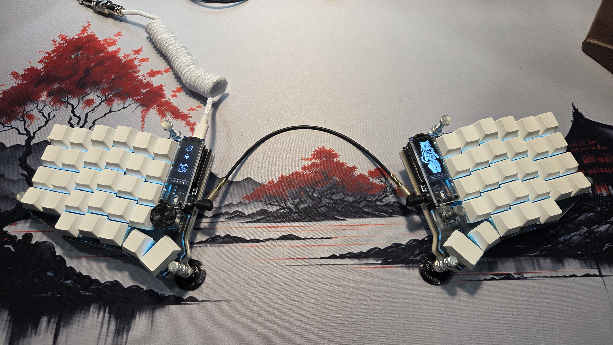
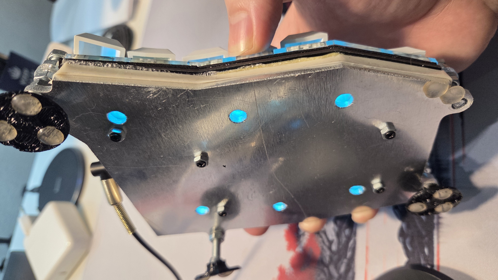
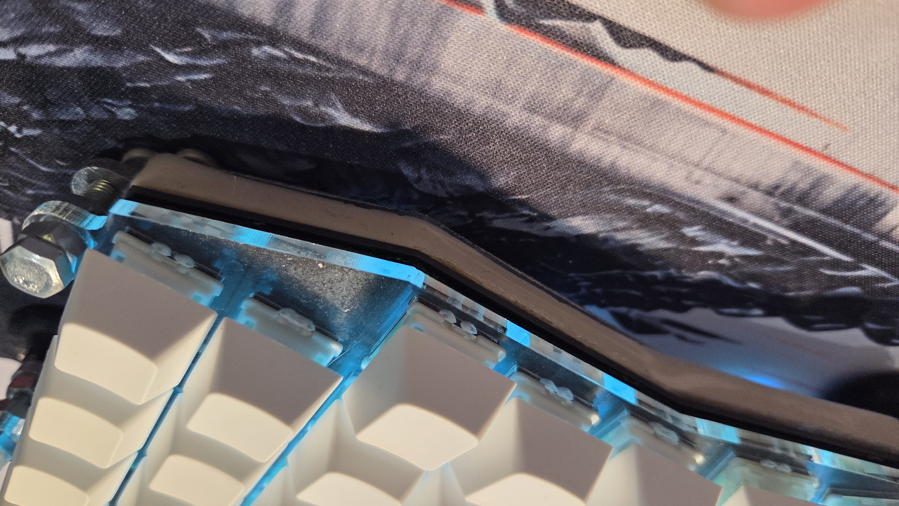
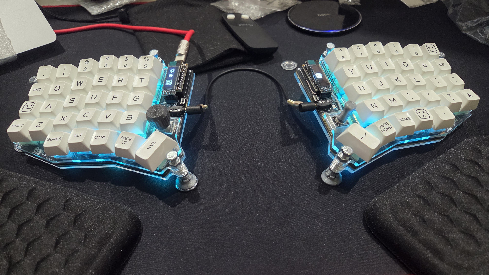
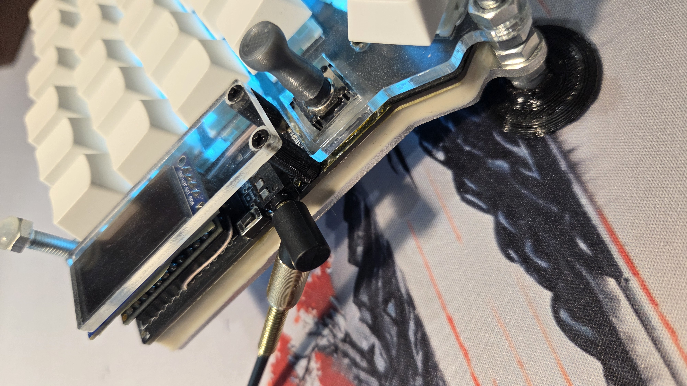
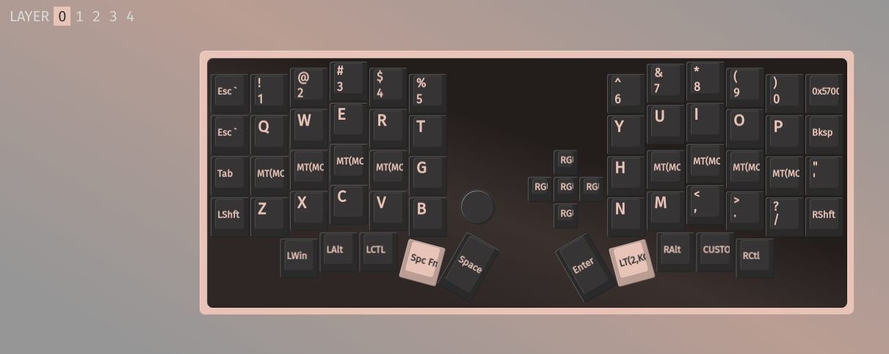
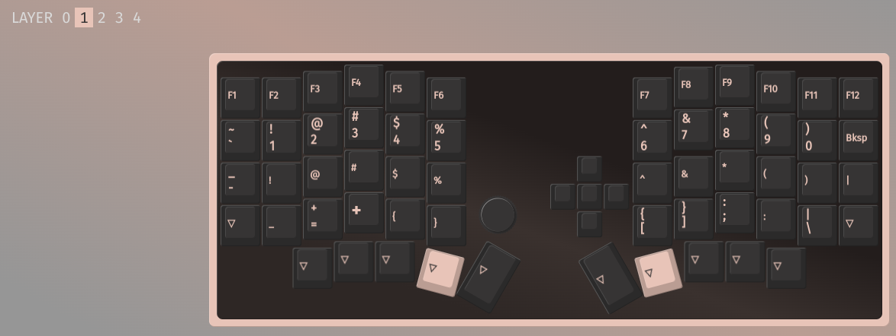
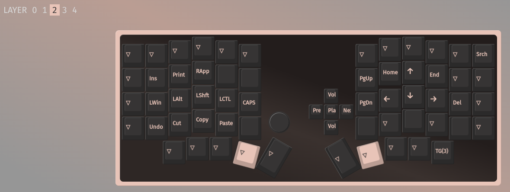
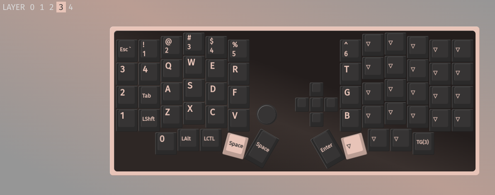

# Sofle RGB Custom firmware

Upstream-QMK firmware for a PandaKB Sofle RGB build with two hardware changes:

- the stock 32x128 OLEDs are replaced by 64x128 SH1107 displays;
- the right rotary encoder is replaced by a five-way switch wired as the right
  matrix's seventh column on `GP28`.

The keyboard uses RP2040 controllers, keeps the left encoder, and drives 72 RGB
Matrix LEDs split evenly between the halves.



## Firmware layout and support

The QMK package mirrors its collision-free build identifier at
[`keyboards/rustyc0der/sofle`](keyboards/rustyc0der/sofle). Do not install it as
`sofle/sofle`: that path collides with and inherits settings from QMK's unrelated
upstream Sofle family.

Two keymaps are maintained:

- `default` is a conventional QWERTY keymap with ordinary five-way-switch and
  encoder assignments. It does not enable VIA or personal behavior.
- `j64` is the personal VIA keymap with four compiled layers, five dynamic
  layers, home-row mods, Space/Enter layer-taps, tap dance, Caps Word, OLED pet
  rendering, encoder maps, and red gaming-layer indication.

The former `vialj64` target and Vial-only files have been removed. This project
supports current upstream QMK and VIA; supporting the separate Vial firmware
fork would require a separately maintained change.

The audited baseline is QMK `0.34.7` at commit
`180f394b489c238cb231c2bf8b080262155e03c0`, with that checkout's pinned
submodules. Build from the QMK checkout after creating the safe vendor-directory
symlink documented in the [keyboard README](keyboards/rustyc0der/sofle/readme.md):

```sh
qmk compile -kb rustyc0der/sofle -km default
qmk compile -kb rustyc0der/sofle -km j64
```

Flash the selected UF2 to both halves. The keyboard README contains the full
installation and flashing procedure.

## VIA

Build and flash `j64`, then load [`via/sofle-via.json`](via/sofle-via.json) as a
draft definition in VIA's Design tab. See the [VIA definition
guide](via/README.md) for exact steps. VIA is not enabled by `default`.

## Hardware notes

### Case and dampening

The build retains the stock tenting case with a transparent acrylic top and an
aluminium bottom. It also uses a custom-molded silicone sound absorber, painter's
tape, and PE foam. A platinum-cure silicone is preferable to the oily tin-cure
compound used in the first version.




### Displays

The two displays are 1.3-inch 64x128 SH1107 modules. The original build used
[these displays](https://www.aliexpress.com/item/1005005777499038.html).



### Five-way switch

The right encoder position uses a
[five-direction switch](https://www.aliexpress.com/item/1005004108793838.html).
Its five contacts occupy matrix positions `[5,6]` through `[9,6]`.



### Switches and keycaps

The photographed build uses Keychron Smoothie switches and blank white Cherry
profile PBT keycaps.

## j64 keymap

The base layer uses CSAG-style home-row mods, Space and Enter layer-taps, Caps
Word, and five-way shortcuts for window positioning. The gaming layer replaces
home-row mod-taps with ordinary keys and turns the intended RGB indicators red.






Migration evidence is in [`docs/`](docs), and the physical post-flash procedure
is in the [manual hardware checklist](docs/hardware-validation.md).
